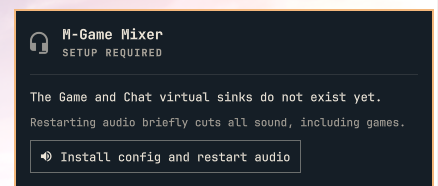

# M-Game Mixer (Omarchy plugin)

A bar widget for the **M-Audio M-Game RGB Dual** on Linux. The device shows up
as one 8-channel output. This plugin uses PipeWire to split it into two virtual
stereo sinks, the same Game/Chat split the Windows software gives you:

| Sink | M-Game channels |
|---|---|
| `mgame_game` ("M-Game Game") | FL FR |
| `mgame_chat` ("M-Game Chat") | FC LFE (or `RL RR` / `SL SR`, configurable) |



## Features

- A headset icon in the bar. Its panel has a **Game** strip and a **Chat** strip, each with volume, mute, and "set as default output".
- A list of the apps that are playing audio, with one click to send each to Game or Chat.
- First-run setup: if the virtual sinks are missing, or the chosen channel pair doesn't match the installed config, the panel offers a button. It writes `~/.config/pipewire/pipewire.conf.d/50-mgame-split.conf` and restarts `pipewire pipewire-pulse wireplumber`. **This cuts all audio for a few seconds, games included.**

## Install

```bash
omarchy plugin add https://github.com/crisesarmiento/omarchy-mgame-mixer --enable
```

To work on the plugin, clone the repo and validate it with `omarchy plugin validate <folder>`.

Change the Chat channel pair in the widget settings (`chatPair`). Then open the panel and click **Apply channels and restart audio**.

## Find out which channel is which

```bash
speaker-test -c 8 -t wav -l 1
```

A voice reads out each channel in turn (front left, front right, center, LFE, rear left, rear right, side left, side right). While it plays, turn the Game/Chat knob on the M-Game and listen for which channels change. Set `chatPair` to the pair that follows the Chat side.

## Files

- `manifest.json`, `BarWidget.qml`, `Panel.qml`: the plugin.
- `mgame.py`: helper script. It only calls `pactl` and `systemctl --user`, and passes every value as an argv argument.
- `pipewire/50-mgame-split.conf`: reference copy of the default config. The setup button generates the config from the pair you chose.
- `i18n/`: English and Spanish strings.

## License

MIT
